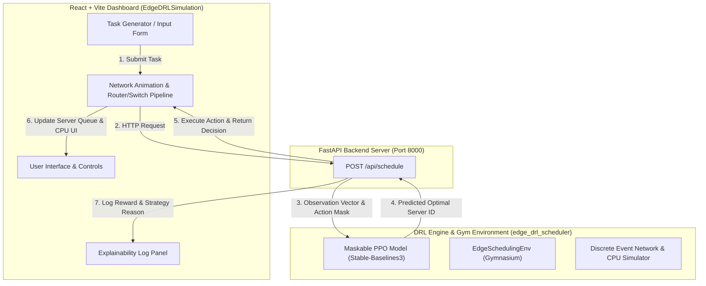

# 🌐 Edge DRL Scheduler & Simulation Dashboard

An end-to-end **Edge Computing Task Scheduler** powered by **Deep Reinforcement Learning (DRL)** with an interactive **React & Vite Visual Dashboard**.

This project solves the challenge of offloading computational tasks in dynamic edge computing environments. By applying **Maskable Proximal Policy Optimization (PPO)**, an AI agent intelligently assigns tasks across distributed edge servers to minimize completion times, prevent server overloads, and meet strict deadlines.

---

## 📐 System Architecture



---

## 🧠 How Everything Works (In Simple Words)

### 1. The Core Problem in Edge Computing
Edge computing places mini-servers closer to user devices (smartphones, IoT sensors, vehicles). When a device creates a heavy task (e.g. video processing or AI inference), it must offload the task to one of the edge servers. 
- If all tasks go to **Server 1**, it gets overloaded, leading to delays and missed deadlines.
- If tasks go to a **farther or slower server**, network transmission delays increase.

### 2. How the DRL Agent Solves It
Instead of using static rules like *Round-Robin* or *Random Choice*, our system trains a **Deep Reinforcement Learning (DRL)** agent:
- **Observation (State):** The AI inspects the current state of all edge servers (CPU availability, active queue length, network latency) and task attributes (data size, required CPU cycles, deadline, priority).
- **Action Masking:** Servers that are offline or don't have enough resources are temporarily masked out so the AI never makes invalid choices.
- **Action (Decision):** The Maskable PPO neural network selects the server that yields the best expected outcome.
- **Reward:** The environment rewards the AI for completing tasks before deadlines and penalizes delays or rejected tasks.

### 3. The Live Visual Dashboard
When you interact with the dashboard at `http://localhost:5173`:
1. You click **"Start Simulation"** or submit a custom task.
2. The task visually travels through a simulated **Router** and **Switch**.
3. The dashboard sends an API request (`POST /api/schedule`) to the Python FastAPI backend.
4. The backend runs the DRL model prediction and returns the selected server ID, acceptance status, and explanation metrics.
5. The dashboard animates the task moving into the target server's queue, updating CPU gauges and real-time logs.

---

## 📂 Project Structure

```
CN_project/
├── EdgeDRLSimulation/           # 💻 Frontend (React + TypeScript + Vite)
│   ├── src/
│   │   ├── components/         # Network diagram, header, task input, explainability log
│   │   ├── services/           # Simulation engine & API connection (http://127.0.0.1:8000)
│   │   └── types/              # TypeScript definitions for Tasks and Servers
│   └── package.json            # Node.js scripts and dependencies
│
└── edge_drl_scheduler/         # 🐍 Backend (Python DRL Engine)
    ├── api/
    │   └── main.py             # FastAPI REST endpoint (/api/schedule)
    ├── environment/            # Gymnasium Edge Scheduling Environment & Task Generators
    ├── models/                 # Saved trained Maskable PPO model checkpoints (.zip)
    ├── training/               # Model training scripts (train_ppo.py, train_ppo_bc.py)
    ├── experiments/            # Benchmark scripts comparing DRL vs standard heuristics
    └── requirements.txt        # Python package dependencies
```

---

## ⚡ Quick Start & How to Run

### Prerequisites
- **Node.js** (v18+)
- **Python** (v3.10+)

---

### Step 1: Start the Python AI Backend Server

Open a terminal window and run:

```bash
# Navigate to the backend directory
cd edge_drl_scheduler

# Install dependencies (if not already installed)
pip install -r requirements.txt

# Launch the FastAPI server on port 8000
uvicorn api.main:app --reload --port 8000
```
*(Backend API will be running at `http://127.0.0.1:8000`)*

---

### Step 2: Start the Visual Dashboard (Frontend)

Open a second terminal window and run:

```bash
# Navigate to the frontend directory
cd EdgeDRLSimulation

# Install Node dependencies (if not already installed)
npm install

# Start the Vite development server
npm run dev
```
*(Frontend dashboard will be running at `http://localhost:5173`)*

---

### Step 3: Test Task Scheduling

1. Open your browser and go to **`http://localhost:5173`**.
2. Click **"Start Simulation"**.
3. Watch tasks flow through the network pipeline and get scheduled onto servers using the DRL policy!

---

## 📊 Benchmarking & Experiments

To evaluate how much better the DRL agent performs compared to classical heuristics (Round Robin, Least Loaded, Min-Execution Time):

```bash
cd edge_drl_scheduler
python experiments/evaluate_agents.py
```

To re-train the Maskable PPO model:
```bash
python training/train_ppo.py
```

---

## 🛠️ API Reference

### `POST /api/schedule`

**Request Body:**
```json
{
  "cpu_requirement": 3,
  "data_size": 15.0,
  "priority": "HIGH",
  "deadline": 500.0,
  "execution_time": 200.0
}
```

**Response Body:**
```json
{
  "task_id": 1,
  "selected_server_id": 2,
  "action_index": 1,
  "action_mask": [true, true, true, true],
  "accepted": true,
  "reward": 45.2,
  "server_assigned": 2
}
```
